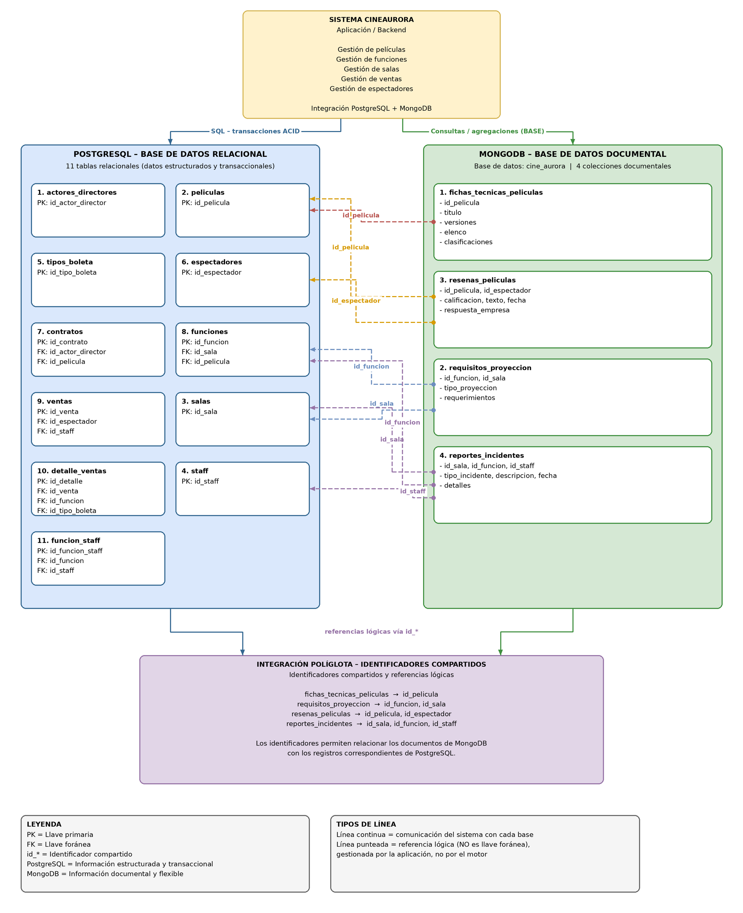
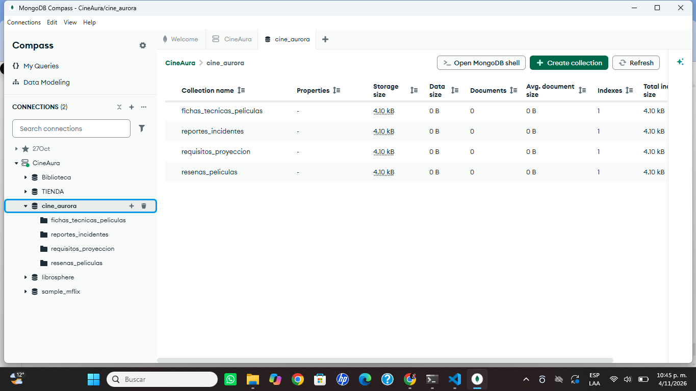
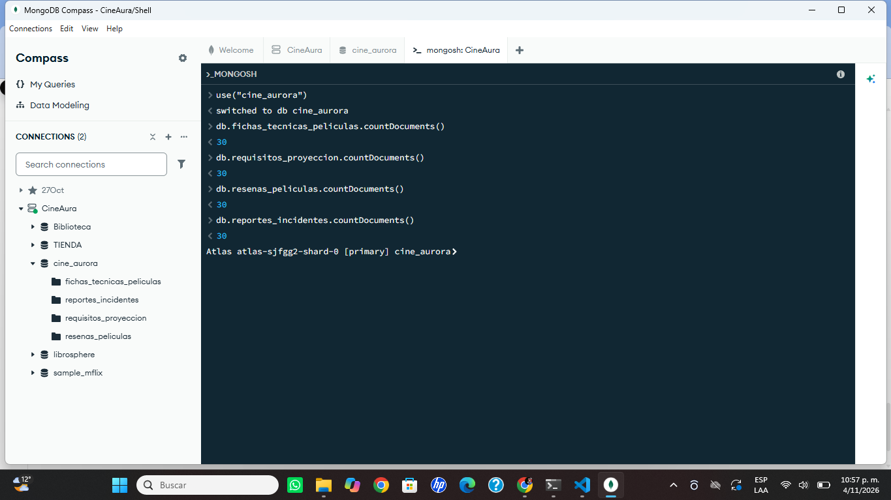
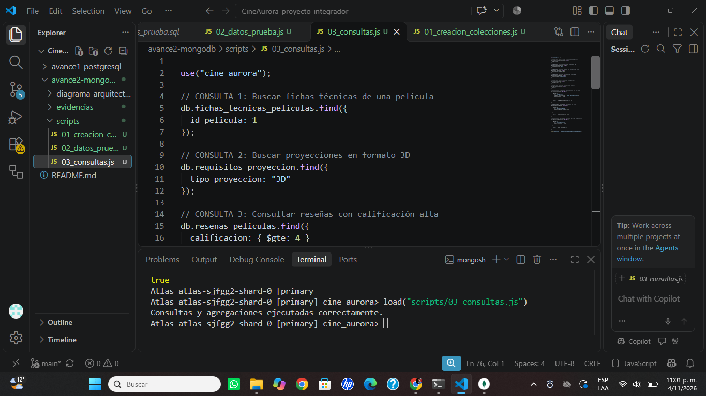

# CINEAURORA
## AVANCE 2 — Capa Documental (MongoDB) y Fundamentos Teóricos

**Proyecto:** Sistema de gestión de CineAurora  
**Asignatura:** Bases de Datos  
**Fecha:** Noviembre de 2026

---

# 1. Introducción

El presente avance desarrolla la capa documental del sistema CineAurora mediante MongoDB. Su propósito es complementar la base de datos relacional PostgreSQL, almacenando información flexible y descriptiva relacionada con las películas, los requisitos técnicos de proyección, las reseñas de los espectadores y los reportes de incidentes.

La integración de ambas tecnologías permite aprovechar las características de cada modelo de base de datos.

# 2. Arquitectura de la solución

El sistema utiliza una arquitectura de persistencia políglota compuesta por PostgreSQL y MongoDB.

**PostgreSQL:** almacena la información estructurada y transaccional del cine, como películas, salas, funciones, ventas, espectadores y personal.

**MongoDB:** almacena información documental que requiere flexibilidad, como fichas técnicas, requisitos de proyección, reseñas e incidentes.

La comunicación entre ambas bases de datos se realiza mediante identificadores compartidos.
### Diagrama de arquitectura políglota

 
# 3. Diseño de las colecciones MongoDB

## 3.1 fichas_tecnicas_peliculas

Almacena información técnica de las películas, incluyendo sus versiones, duración, idioma, subtítulos, elenco y clasificaciones por país.

Identificador relacionado: id_pelicula.

Se utiliza información embebida para las versiones, el elenco y las clasificaciones, debido a que estos datos complementan directamente la ficha técnica.

## 3.2 requisitos_proyeccion

Almacena los requisitos técnicos necesarios para realizar cada función cinematográfica.

Incluye el identificador de la función, la sala, el tipo de proyección y los requerimientos técnicos.

Identificadores relacionados: id_funcion e id_sala.

Los requisitos se almacenan como un documento embebido porque pueden variar dependiendo del tipo de proyección.

## 3.3 resenas_peliculas

Almacena las opiniones de los espectadores sobre las películas.

Incluye la calificación, el texto de la reseña, la fecha y la respuesta de la empresa.

Identificadores relacionados: id_pelicula e id_espectador.

La respuesta de la empresa se almacena embebida porque pertenece directamente a la reseña.

## 3.4 reportes_incidentes

Almacena los incidentes técnicos, quejas y situaciones de seguridad que se presentan en las instalaciones del cine.

Incluye la sala, la función, el personal responsable, el tipo de incidente, la descripción, la fecha y los detalles adicionales.

Identificadores relacionados: id_sala, id_funcion e id_staff.

Se utiliza un objeto embebido llamado detalles, porque la información adicional cambia dependiendo del tipo de incidente.

# 4. Justificación del modelo documental

MongoDB permite almacenar documentos con estructuras flexibles, lo que facilita representar información que puede cambiar dependiendo del contexto.

Se utiliza el modelo embebido cuando los datos tienen una relación directa con el documento principal y normalmente se consultan juntos.

Se utilizan referencias mediante identificadores cuando la información pertenece a entidades administradas por PostgreSQL.

Esta distribución evita duplicar innecesariamente la información principal y permite integrar los dos motores de bases de datos.

# 5. Validaciones mediante JSON Schema

Se implementaron validaciones utilizando $jsonSchema para controlar la estructura de los documentos.

Las cuatro colecciones cuentan con validadores que establecen tipos de datos y campos obligatorios.

Las validaciones ayudan a mantener la consistencia de la información y evitan insertar documentos que no cumplan con las reglas definidas.

# 6. Datos de prueba

Se insertaron 30 documentos en cada colección, para un total de 120 documentos.

| Colección | Documentos |
|---|---:|
| fichas_tecnicas_peliculas | 30 |
| requisitos_proyeccion | 30 |
| resenas_peliculas | 30 |
| reportes_incidentes | 30 |
| Total | 120 |

# 7. Consultas y agregaciones

Se implementaron seis consultas para recuperar información específica:

1. Buscar las fichas técnicas de una película.
2. Buscar proyecciones en formato 3D.
3. Consultar reseñas con calificación igual o superior a cuatro.
4. Consultar incidentes de seguridad.
5. Buscar reseñas de un espectador.
6. Consultar incidentes de una sala.

También se implementaron tres agregaciones:

1. Calcular el promedio de calificaciones y el total de reseñas por película.
2. Obtener la cantidad de incidentes por tipo.
3. Obtener la cantidad de funciones por tipo de proyección.

# 8. Fundamentos teóricos: ACID, BASE y CAP

## 8.1 ACID

ACID representa las propiedades de atomicidad, consistencia, aislamiento y durabilidad.

En CineAurora, estas propiedades son importantes para las operaciones transaccionales, especialmente las ventas de boletas, los pagos y la asignación de funciones.

PostgreSQL es adecuado para estas operaciones porque ofrece transacciones ACID.

## 8.2 BASE

BASE representa disponibilidad básica, estado flexible y consistencia eventual.

Este enfoque resulta útil para información documental como reseñas, fichas técnicas y reportes de incidentes, donde se puede priorizar la disponibilidad y flexibilidad de almacenamiento.

MongoDB permite trabajar con documentos flexibles y ofrece configuraciones de consistencia que deben seleccionarse según las necesidades del sistema.

## 8.3 CAP

El teorema CAP establece que en presencia de una partición de red un sistema distribuido debe priorizar entre consistencia y disponibilidad.

En CineAurora es importante considerar este principio al integrar diferentes tecnologías de almacenamiento.

La elección depende del tipo de operación: las ventas requieren consistencia fuerte, mientras que algunas consultas documentales pueden tolerar actualizaciones con consistencia eventual.

# 9. Conclusiones

La implementación de MongoDB permite complementar la estructura relacional de PostgreSQL mediante documentos flexibles.

Las cuatro colecciones desarrolladas permiten administrar información técnica de películas, requisitos de proyección, reseñas e incidentes.

La arquitectura políglota aprovecha las fortalezas de ambas tecnologías y permite organizar la información según sus características.

La implementación de validaciones, datos de prueba, consultas y agregaciones constituye una base para continuar con la integración del sistema CineAurora.

# 10. Evidencias

## 10.1 Creación de colecciones

## 10.2 Documentos insertados

## 10.3 Consultas y agregaciones

## 10.4 Diagrama de arquitectura

